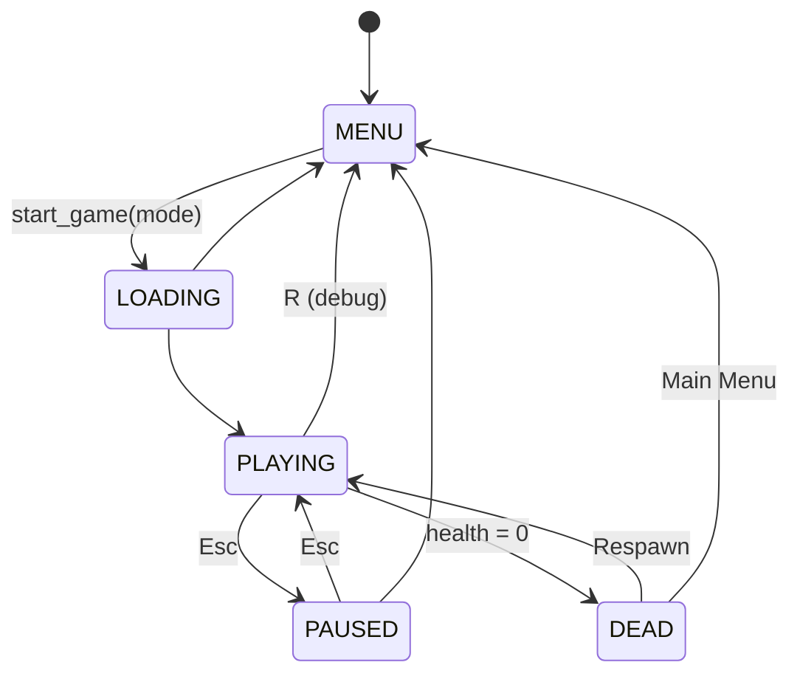

# ARQUITETURA - ᴇɴ

This document describes how the game is organized: the modules, how they connect, the flow of a gameplay session, and the design decisions behind the code.
For installation instructions, see the [README](../README.md);
For contribution guidelines, see [CONTRIBUTING](../CONTRIBUTING.md).

## Table of Contents

- [Overview](#overview)
- [Initialization (`main.py`)](#initialization-mainpy)
- [State Machine](#state-machine)
- [Game Modes](#game-modes)
- [World and Storage](#world-and-storage)
- [Player and Physics](#player-and-physics)
- [Health and Hunger](#health-and-hunger)
- [Day/Night Cycle](#daynight-cycle)
- [Registries: Textures, Blocks, Items, and Entities](#registries-textures-blocks-items-and-entities)
- [Interface: Hotbar, Inventory, HUD, and Menus](#interface-hotbar-inventory-hud-and-menus)
- [Crafting](#crafting)
- [Sounds and Particles](#sounds-and-particles)
- [Input Loop](#input-loop)
- [Testing and CI](#testing-and-ci)
- [How to Extend](#how-to-extend)
- [Known Limitations and Open Issues](#known-limitations-and-open-issues)

## Overview

Pythoncraft is a first-person voxel sandbox built on **[Ursina](https://www.ursinaengine.org)** (which, in turn, uses **Panda3D**). The terrain is generated using **Perlin noise**. The architecture follows three main concepts:

1. **`main.py` acts as the orchestrator.** It creates the application, loads the registries, instantiates the UI exactly once, and responds to changes in the game state. The actual game logic resides in the `game/` modules.
2. **Pure logic is decoupled from the engine.** Game state (`state.py`), physics and fall damage (`physics.py`), health/hunger (`vitals.py`), the day/night cycle (`daynight.py`), game mode rules (`modes.py`), inventory and interactions (`container.py`), mining mechanics (`mining.py`), and crafting recipes (`craft.py`) do not depend on Ursina entities, making them testable via `unittest`. Classes that interface with the engine—such as `PlayerController`, `DayNightLighting`, or `Hotbar`—simply apply the results of this logic to the scene.
3. **Global registries indexed by ID.** Blocks, items, entities, and textures are stored in module-level dictionaries (`BLOCKS`, `ITEMS`, `ENTITIES`, `textures.blocks`, etc.), keyed by strings (e.g., `"stone"`, `"apple"`). The rest of the codebase operates using these IDs; the actual objects are retrieved via helper functions like `get_block`, `get_item`, and `get_entity`.

## Initialization (`main.py`)

The order of operations is critical: the Ursina application must be initialized before any `Entity` is created, and the registries depend on the availability of textures:

1. `os.chdir` is used to set the working directory to the project root—this ensures all assets can be loaded using relative paths (e.g., `assets/...`).
2. `app = Ursina()` is called **before** importing modules from `game.*` (as several of these modules create entities upon import—for instance, `world_parent` in `world.py`).
3. Window configuration (`window.*`) is applied. 4. Loading of registries, in this mandatory order:
`load_all_textures()` → `load_all_items()` → `load_all_entities()` → `load_all_blocks()`.
5. One-time creation of the in-game UI: crosshair, `PlayerInventory` (the model), `Hotbar`, `InventoryScreen`, `CraftingTableScreen`, `HUD`, `BreakingOverlay`, and `DayNightLighting`. These objects are reused across game sessions and respawns—simply toggled between hidden and visible states.
6. Registration of state machine callbacks (`game.on_enter(...)` / `game.on_exit(...)`).
7. `ui.build_main_menu(start_game)` and `ui.build_death_screen(_respawn, quit_to_menu)`.
8. `app.run()`. From this point on, Ursina calls `input(key)` from `main.py` and the `update()` method for each entity on every frame.

The `--debug` flag (`python main.py --debug`) enables development shortcuts, such as pressing `R` to return to the menu.

## State Machine

`game/core/state.py` defines the `State` enum and the `game` singleton (`GameState`), which also stores the current game session data (e.g., `game.player`, `game.mode`).

- Permitted transitions are defined in the `TRANSITIONS` table; an invalid transition triggers an `InvalidTransition` error. - `game.change(new_state)` triggers the following, in order: **exit** callbacks for the current state (which receive the next state as an argument) → updates `game.state` → **entry** callbacks for the new state (which receive the previous state as an argument).
- The behavior of each entry callback is determined by `main.py` based on the previous state. For example, `_enter_playing` performs different actions depending on the prior state: if coming from `LOADING`, it creates the player; if from `DEAD`, it respawns the player while preserving the world; if from `PAUSED`, it simply reactivates the player and locks the mouse.

by caiothedev 
#architecture